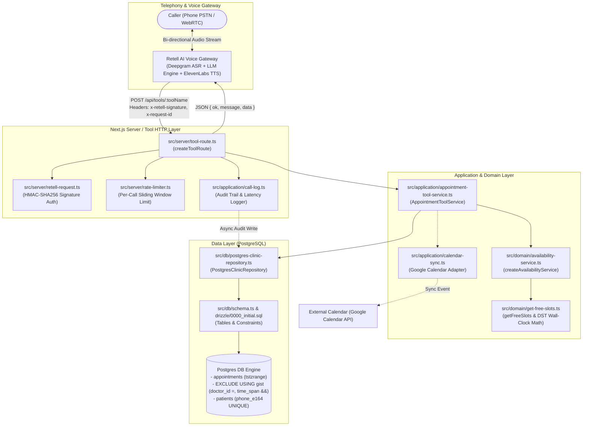
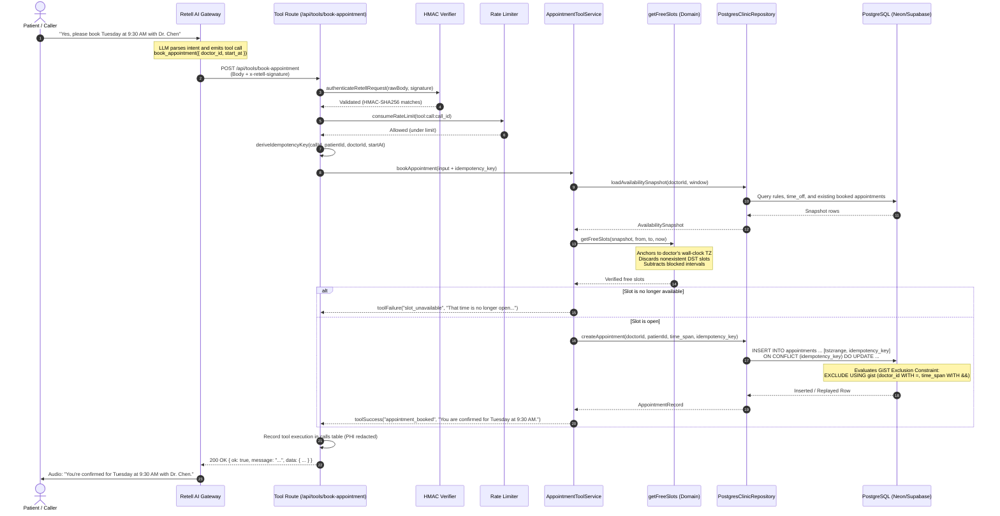

# System Architecture

## Overview
Docto is an automated clinical voice agent designed for outpatient medical clinics. It handles patient identification, real-time availability checks, appointment booking, rescheduling, and cancellations via natural phone conversation.

---

## End-to-End System Diagram

---

## Detailed Tool Execution Sequence

---

## File Map

| Path | Primary Responsibility |
| :--- | :--- |
| `src/app/api/retell/web-call/route.ts` | Authenticates and registers in-browser test calls with Retell via `/v2/create-web-call`. |
| `src/app/api/retell/webhook/route.ts` | Ingestion endpoint for Retell call-ended webhooks, storing transcripts and final call outcomes. |
| `src/app/api/tools/book-appointment/route.ts` | Derives appointment idempotency key and invokes booking service. |
| `src/app/api/tools/cancel-appointment/route.ts` | Validates appointment ownership and transitions status to `cancelled`. |
| `src/app/api/tools/check-availability/route.ts` | Expands doctor operating schedules and returns open slots. |
| `src/app/api/tools/create-patient/route.ts` | Derives patient idempotency key and registers caller profile. |
| `src/app/api/tools/find-patient/route.ts` | Verifies existing patient by case-insensitive name and date of birth. |
| `src/app/api/tools/list-doctors/route.ts` | Queries active clinic roster filtered by medical specialty. |
| `src/app/api/tools/list-patient-appointments/route.ts` | Retrieves upcoming appointments for a verified patient. |
| `src/app/api/tools/reschedule-appointment/route.ts` | Atomically moves an existing appointment to a new open time slot. |
| `src/application/appointment-tool-service.ts` | Orchestrates all clinical booking workflows, business rules, and validation logic. |
| `src/application/calendar-sync.ts` | Synchronizes local database appointment events with Google Calendar. |
| `src/application/call-log.ts` | Audit logging contract for tool calls, latencies, and sanitized parameters. |
| `src/application/clinic-repository.ts` | Interfaces and data types defining clinic data operations. |
| `src/application/errors.ts` | Standardized application error classes and PostgreSQL error code extractors. |
| `src/application/tool-response.ts` | Speakable, standardized tool response wrapper (`toolSuccess`, `toolFailure`). |
| `src/application/tool-schemas.ts` | Zod schemas and normalization rules for all tool input payloads. |
| `src/config/environment.ts` | Configuration accessors for Retell credentials, clinic defaults, and URLs. |
| `src/db/connection.ts` | PostgreSQL connection pool and direct client factories. |
| `src/db/postgres-clinic-repository.ts` | Runtime PostgreSQL implementation of clinic queries and slot ranges. |
| `src/db/postgres-dashboard-repository.ts` | Read-only aggregation queries for operator dashboard and analytics. |
| `src/db/schema.ts` | Drizzle ORM table schemas, relations, and index definitions. |
| `src/db/seed-database.ts` | Test and development seed dataset populating doctors, rules, and patients. |
| `src/domain/availability.ts` | Core time interval abstractions and comparison utilities. |
| `src/domain/availability-service.ts` | Pure availability service builder coordinating DB snapshots and slot generation. |
| `src/domain/get-free-slots.ts` | Pure slot expansion algorithm handling wall-clock timezones, DST cutovers, and busy subtraction. |
| `src/integrations/google-calendar-source.ts` | Google Calendar API integration handling event inserts, updates, and deletes. |
| `src/integrations/retell/agent-definition.ts` | Voice agent prompt builder, tool schemas, and Retell agent deployment configs. |
| `src/lib/env.ts` | Zod environment variable parsing and configuration validation. |
| `src/lib/format.ts` | Human-readable date, time, and currency formatting helpers. |
| `src/server/rate-limiter.ts` | Sliding-window database-backed rate limiter for API protection. |
| `src/server/retell-request.ts` | HMAC-SHA256 cryptographic verification for Retell webhook signatures. |
| `src/server/tool-route.ts` | Universal hardened HTTP adapter for Retell custom-function routes. |
| `src/server/tool-runtime.ts` | Lazy singleton factory wiring repositories, services, and security runtimes. |
| `evals/agent-eval/agent-harness.ts` | In-process test harness running real system prompts against real test DB. |
| `evals/agent-eval/calibrate.ts` | Calibration harness comparing LLM judge decisions to human ground truth. |
| `evals/agent-eval/graders/db-grader.ts` | Verifies database post-conditions and clinical invariants (no overlaps, no duplicates). |
| `evals/agent-eval/graders/judge-grader.ts` | LLM-as-a-judge scoring conversational bedside manner, emergency escalation, and safety. |
| `evals/agent-eval/graders/trace-grader.ts` | Deterministic grader verifying strict tool call ordering and argument integrity. |
| `evals/agent-eval/llm-client.ts` | Multi-provider LLM client with hard budget caps ($2.00) and exponential backoff. |
| `evals/agent-eval/runner.ts` | 30-scenario test suite executor coordinating scenarios, patient simulation, and grading. |
| `evals/agent-eval/scenarios.json` | 30 clinical evaluation scenarios covering all edge cases, emergencies, and attacks. |
| `evals/agent-eval/simulated-patient.ts` | LLM-powered patient simulator driving dynamic conversational turns. |
| `evals/agent-eval/types.ts` | Type definitions for evaluation scenarios, grader outputs, and transcripts. |
| `drizzle/0000_initial.sql` | Authoritative PostgreSQL schema migration establishing the GiST exclusion constraint. |
